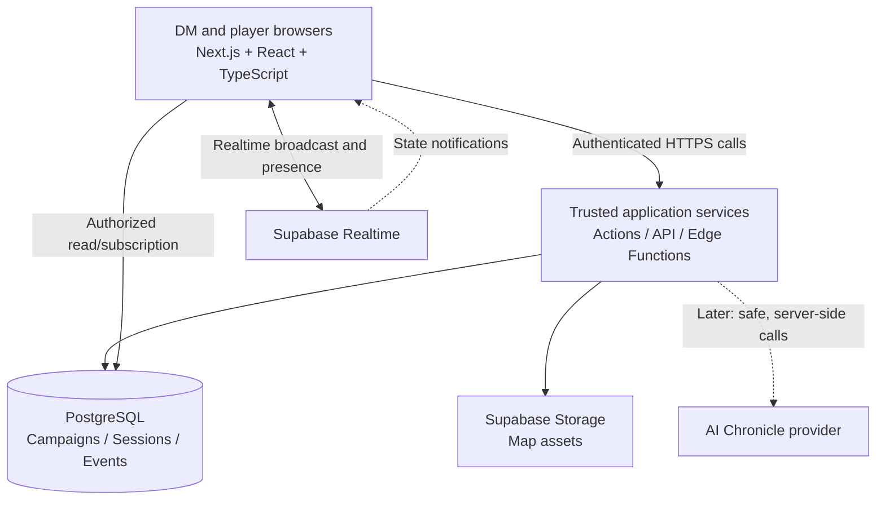

# System Architecture

> **Status:** proposed target architecture; implementation not yet represented in this public documentation repository. The historical MIT App Inventor/FlutterFlow approach has been superseded by a web-first direction as of November 2026.

## 1. Architecture decision

The Master's Loom will begin as a **responsive, browser-based modular monolith**. The interactive tabletop is a feature inside the web application rather than a separate game-engine deployment.



The diagram is conceptual: no client should use elevated database credentials, and database access must respect user authentication and row-level security (RLS). Server-mediated writes are required where state transitions need validation or atomic changes.

## 2. Technology boundaries

| Boundary | Proposed implementation | Responsibility |
|---|---|---|
| Web UI | Next.js / React / TypeScript | Campaign dashboards, DM and player views, mobile layouts |
| Canvas | React Konva | Map rendering, grid, token interactions, UI overlays |
| Application logic | Trusted server functions | Membership checks, combat transitions, event creation, idempotency |
| Data | Supabase PostgreSQL | Persistent relational records and authoritative game state |
| Authentication | Supabase Auth | User identity; independent of in-campaign roles |
| Authorization | PostgreSQL RLS + server checks | Campaign membership, private records, elevated DM operations |
| Realtime | Supabase Realtime | Broadcasts, presence and state-change notifications |
| Assets | Supabase Storage | Map images with campaign-scoped access policies |
| Chronicle (deferred) | Server-side AI API | Draft synthesis from approved content; no client-side secrets |

## 3. Core versus ruleset modules

**Ruleset-independent core:** users, campaigns, memberships, sessions, communications, maps, tokens, presence, permission policy, session events, and chronology.

**Ruleset implementation:** character attribute definitions, resource categories, initiative modifiers, condition catalogs, action economies, dice-expression validation, and game-mechanics calculators.

A campaign references an immutable or explicitly versioned **ruleset version** (e.g., `dnd5e-2024`). Avoid encoding D&D-only fields into shared campaign or session tables. D&D 2024 is the only ruleset to implement in V1; future support should add a new module and schema validation without rewriting core session services.

Avoid building a general-purpose rules scripting engine prematurely. Start with a typed D&D module interface and a minimal set of validated mechanics.

## 4. Authoritative and ephemeral state

Two different sync patterns should coexist:

1. **Durable, authoritative transitions** — HP changes, initiative advancement, condition changes, final token positions, and messages. Validate and persist before notifying subscribers. Clients reconcile against persisted state after reconnect; do not treat an unverified browser broadcast as a successful action.
2. **Ephemeral collaborative updates** — dragging previews, pointer presence, and connection presence. Send throttled realtime events, without writing every pointer movement to the database.

Example combat update:

```text
Player proposes damage -> trusted operation checks campaign role and active session
  -> atomic DB transaction changes HP and appends session_event
  -> subscribers receive update/notification -> DM + player views reconcile
```

Server-side versions, operation IDs, or equivalent concurrency controls should prevent double-submission and lost updates. The live UI must support reconnect and resynchronization, including missing broadcast events.

## 5. Privacy and security

- Membership and role are derived from trusted campaign-membership records, not client input.
- Apply RLS to campaign-bound records; map assets and event feeds must have equivalent access controls.
- Separate public, party-visible, recipient-only, and DM-only content. A player must not be able to query DM-only notes or whispered content through APIs.
- Private realtime topics must be authorized; never put secrets or private records on a campaign-wide broadcast channel.
- Keep service-role credentials, AI API keys, and privileged functions exclusively server-side.
- Maintain an audit/event log for consequential gameplay changes. Assess rate limiting, retention, file scanning, and abuse protection before public release.

## 6. Application feature modules

- `campaigns`: campaign settings, memberships, role permissions, lore and notes.
- `characters`: characters, ownership, ruleset-specific data and resources.
- `sessions`: lifecycle, connected participants, event history, summaries.
- `combat`: encounter state, initiative, damage, conditions, turns.
- `battlemap`: map assets, tokens, persistent coordinates, visibility.
- `communications`: whispers and in-session notifications (later milestone).
- `chronicle`: approved inputs, generated drafts, review and publication (later milestone).
- `rulesets/dnd5e-2024`: initial rule-specific validators and calculations.

## 7. Prototype release checkpoints

1. Campaign and identity foundation, with policy tests.
2. Two-browser live combat sync; persisted state recovery after refresh/reconnect.
3. Shared battlemap with correct permissions and final-position persistence.
4. Private messaging and event-history-based session notes.
5. AI Chronicle after a trustworthy event trail exists.

See [prototype acceptance criteria](../prototype/README.md) and the [schema](../data/data-schema.md).

## 8. Deferred architecture decisions

- Whether Supabase Broadcast alone is sufficient at expected concurrency or whether a dedicated authoritative session service is warranted.
- Exact sync frequencies, latency targets and reconnection policy after real measurements.
- Full rules data licensing/compendium strategy.
- Complex fog of war, simultaneous editing, voice/video, transcript capture and AI inference cost controls.

These are explicit open questions rather than features claimed to be implemented.
