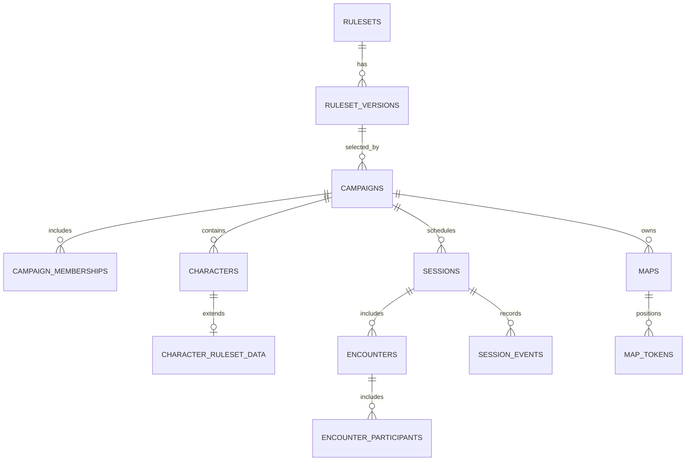

# Data Schema & Ruleset Boundaries

> **Status:** conceptual PostgreSQL schema for a proposed Supabase-backed web prototype. Tables below are **not** implemented migrations. Earlier App Inventor field lists were learning artifacts and are superseded by this design.

## 1. Modeling principles

- Use UUID primary keys and explicit foreign keys for shared entities.
- Associate tenant-scoped records with a campaign (directly or via a verified relationship).
- Distinguish a person's authenticated account from their membership in an individual campaign and from characters they control.
- Pin campaigns to a specific ruleset **version**; other RPGs are future modules.
- Keep durable state relational where integrity and queries matter; use validated `jsonb` for variable game-system data.
- Store key state transitions in append-only `session_events`; do not use event history as an excuse to skip authoritative current-state tables.
- Use `timestamptz` for timestamps, enforce constraints, and enable RLS. Sensitive message/event visibility must be enforced by trusted authorization rules.

## 2. Core entities (proposed)

| Entity | Important fields | Relationship and intent |
|---|---|---|
| `rulesets` | `id`, `slug`, `display_name` | Registry of supported game systems |
| `ruleset_versions` | `id`, `ruleset_id`, `version_key`, `schema_version`, `status` | One ruleset to many explicitly versioned implementations |
| `profiles` | `user_id`, `display_name` | Auth user-linked profile; identity comes from Supabase Auth |
| `campaigns` | `id`, `name`, `owner_user_id`, `ruleset_version_id`, `created_at` | Campaign belongs to a chosen ruleset version |
| `campaign_memberships` | `campaign_id`, `user_id`, `role`, `status` | Campaign-scoped DM/player membership; unique `(campaign_id,user_id)` |
| `characters` | `id`, `campaign_id`, `owner_user_id`, `name`, `character_type` | Character identity, ownership, and campaign association |
| `character_ruleset_data` | `character_id`, `ruleset_version_id`, `schema_version`, `data jsonb` | Game-specific stats; validated against selected ruleset |
| `sessions` | `id`, `campaign_id`, `status`, `started_at`, `ended_at` | A campaign's play sessions |
| `encounters` | `id`, `session_id`, `status`, `round_number`, `active_turn_id` | Active or archived combat context |
| `encounter_participants` | `id`, `encounter_id`, `character_id`, `initiative`, `turn_order` | Actors in an encounter; NPC support through character type or dedicated actor model |
| `character_resources` | `id`, `character_id`, `resource_key`, `current_value`, `max_value`, `version` | HP and other counters with ruleset-specific semantics |
| `maps` | `id`, `campaign_id`, `asset_path`, `grid_config jsonb`, `visibility` | Campaign map and its controlled asset |
| `map_tokens` | `id`, `map_id`, `character_id`, `x`, `y`, `visibility`, `version` | Durable token identity and final position |
| `session_events` | `id`, `session_id`, `actor_user_id`, `event_type`, `payload jsonb`, `visibility`, `created_at`, `operation_id` | Append-only activity stream, ordered per session where needed |
| `session_notes` | `id`, `session_id`, `author_user_id`, `body`, `visibility` | Authored notes; visibility must be authorized |

`character_resources` is a practical candidate for a common interface, but not every game system uses hit points. The generic core must not assume every ruleset has HP, armor class, or spell slots.

## 3. D&D 2024-specific data

Illustrative `character_ruleset_data.data` for an initial D&D 2024 character:

```json
{
  "abilities": {"str": 12, "dex": 16, "con": 14, "int": 10, "wis": 13, "cha": 8},
  "class_levels": [{"class_key": "ranger", "level": 5}],
  "armor_class": 16,
  "speed_ft": 30,
  "proficiency_bonus": 3
}
```

This is an **illustrative application record**, not a definitive D&D 2024 schema or licensed rules content. HP and other frequently changing resources should have validated durable state rather than relying only on full JSON document replacements. Implement D&D rule validation in a versioned ruleset module.

**Proposed module contract** (logical, not yet coded):

```ts
interface RulesetModule {
  key: string; // e.g. "dnd5e-2024"
  validateCharacter(input: unknown): ValidationResult;
  getCharacterSummary(data: unknown): CharacterSummary;
  getInitiativeModifier(data: unknown): number | null;
  validateResourceChange(input: unknown): ValidationResult;
}
```

Keep the shared app responsible for persistence, authorization, events, and presentation. The module determines mechanics and field semantics.

## 4. Follow-on entities

| Entity | Intended phase |
|---|---|
| `private_messages` with sender/recipient and restrictive RLS | Whisper network |
| `chronicle_jobs` and `chronicle_drafts` | AI session recaps with DM review |
| `lore_entries`, `npcs`, `quests`, `locations` | Richer campaign management |
| `inventory_items`, `character_inventory` | Inventory and equipment |
| `ruleset_content` (licensed/reference-only) | Future authorized compendium support |

## 5. Example relationships



## 6. Transaction and access invariants

- A character's owner must be an authorized campaign member (or nullable for DM-controlled NPCs), checked in trusted operations.
- Session events must reference the same campaign context as their session and actors.
- A campaign's selected ruleset version determines its character-data validator; version changes require an explicit migration plan.
- Combat state changes and corresponding event insertion must succeed or fail atomically.
- Use unique `operation_id` to make repeated mutation requests safe against retries.
- Private messages, hidden tokens, DM notes, and event payloads must never leak through permissive SELECT policies or realtime broadcasts.

**Implementation next step:** translate this model into migrations, indexes, RLS policies, and integration tests. Do not consider this Markdown document a deployed database.
